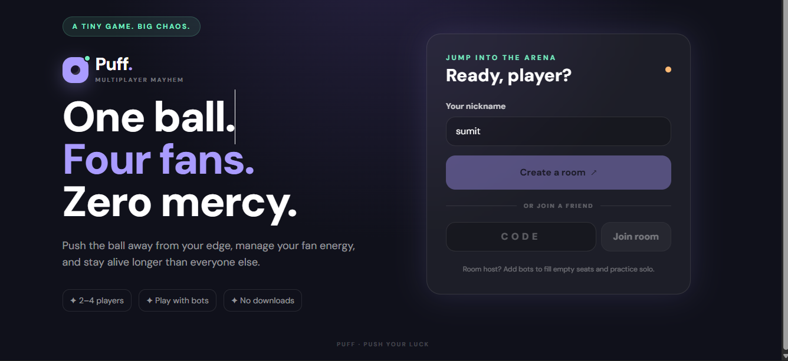
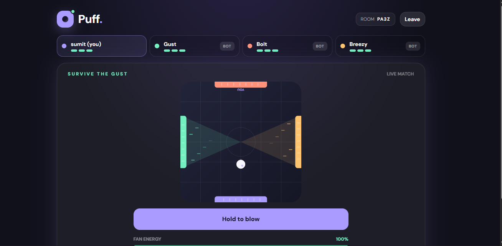
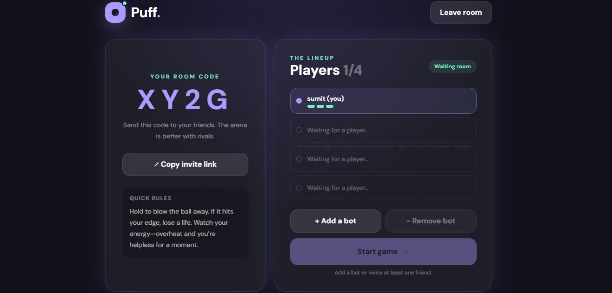

# Puff

Puff is a real-time multiplayer survival game where 2–4 players share a square arena and use fans to push a single ball away from their own edge. Each player has three lives. Lose all your lives and you're eliminated—the last player standing wins. Hosts can also add bots to practice solo.

## Screenshots

### 1. Gameplay



### 2. Multiplayer Match



### 3. Creating a Room



---

## 🔗 Live Demo

**Play Puff:** [https://puff-sd09.onrender.com](https://puff-sd09.onrender.com)

**GitHub Repository:** [https://github.com/sum9548/Puff](https://github.com/sum9548/Puff)

## Features

- Real-time multiplayer gameplay
- Room creation and joining with a room code
- Fan controls to push the ball away from your edge
- Three lives per player
- Fan energy management and temporary overheating
- Bots for solo practice
- React-based game interface with HTML Canvas rendering

## Tech Stack

- **Frontend:** React 18, Vite, Tailwind CSS, HTML Canvas
- **Backend:** Node.js, Express
- **Real-time communication:** Socket.IO
- **Storage:** In-memory game rooms (no database required)

## Project Structure

```text
Puff-React-Tailwind-Standalone/
├── package.json
├── package-lock.json
├── .gitignore
├── README.md
├── server/
│   ├── server.js
│   └── src/
│       ├── config.js
│       ├── utils.js
│       ├── rooms.js
│       ├── physics.js
│       ├── bots.js
│       ├── snapshot.js
│       ├── gameLoop.js
│       └── socketHandlers.js
└── client/
    ├── package.json
    ├── index.html
    ├── vite.config.js
    ├── tailwind.config.js
    ├── postcss.config.js
    └── src/
        ├── main.jsx
        ├── App.jsx
        ├── index.css
        ├── components/
        │   ├── Brand.jsx
        │   └── ArenaCanvas.jsx
        ├── hooks/
        │   └── useGameSocket.js
        └── socket/
            └── client.js
```

## Requirements

- Node.js 18 or newer
- npm

## Run in Development

From the project root, install dependencies:

```bash
npm install
npm --prefix client install
```

Start the backend and frontend:

```bash
npm run dev
```

Open the Vite URL shown in your terminal, usually `http://localhost:5173`.

Open the game in two browser tabs or separate devices. Create a room in one and join using its room code in the other. The host can add bots from the lobby.

## Production Build and Run

From the project root:

```bash
npm install
npm --prefix client install
npm run build
npm start
```

Open `http://localhost:3000` if your `.env` sets `PORT=3000`.

The Express server serves the built React frontend and handles multiplayer communication through Socket.IO from the same origin.

## Deployment

Puff can be deployed as a Node.js web service on a platform such as Render.

- **Build command:** `npm install && npm run build`
- **Start command:** `npm start`

Deploy from the project root. The hosting platform must support WebSocket connections and provide the port through its environment configuration.

After deployment, test room creation and joining using separate browsers or devices.

## Game Rules

- Hold the fan control or press the Space bar to blow the ball away from your edge.
- If the ball touches your edge, you lose one life.
- Fan energy drains while blowing and recharges when released.
- Running out of energy temporarily overheats the fan.
- The last player with lives remaining wins.

## Challenge Submission

- **Title:** Puff
- **Description:** Puff is a fast-paced multiplayer survival game where 2–4 players use fans to push one shared ball away from their edge. Manage your fan energy, avoid the ball, and be the last player standing. Share a room code or add bots to practice solo.
- **Cover image:** Capture the arena during a match with the ball and fan effects visible.
- **Project URL:** Add your deployed game URL after deployment.
